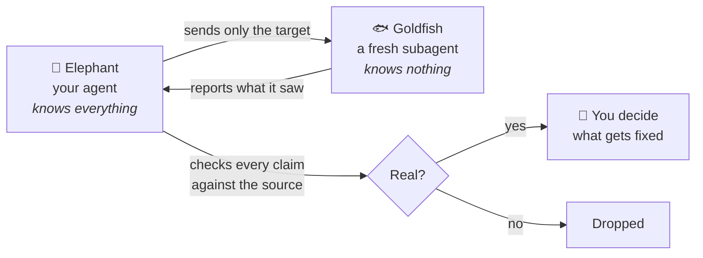
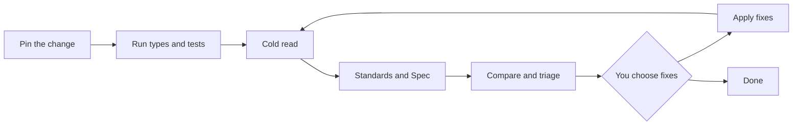
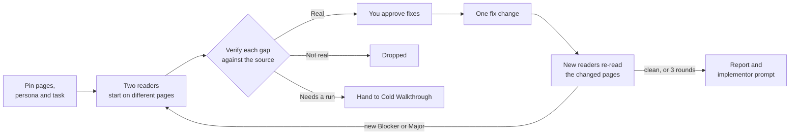
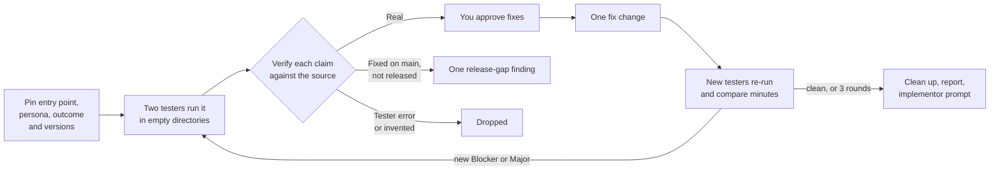

<p align="center">
  
</p>

<h3 align="center">Focused workflows for AI coding agents.<br>The agent does the legwork. You make the calls.</h3>

<p align="center">
  <a href="#install">Install</a> &ensp;·&ensp;
  <a href="#which-skill-do-i-need">Which skill?</a> &ensp;·&ensp;
  <a href="#the-idea">The idea</a> &ensp;·&ensp;
  <a href="#cold-review">Cold Review</a> &ensp;·&ensp;
  <a href="#guided-review">Guided Review</a> &ensp;·&ensp;
  <a href="#cold-docs">Cold Docs</a> &ensp;·&ensp;
  <a href="#cold-walkthrough">Cold Walkthrough</a> &ensp;·&ensp;
  <a href="#pr">PR</a> &ensp;·&ensp;
  <a href="#faq">FAQ</a>
</p>

<p align="center">
  <a href="LICENSE"></a>
  <a href="#skills-at-a-glance"></a>
  <a href="https://github.com/vercel-labs/skills"></a>
  
  
</p>

<br>

AI agents write code faster than anyone can check it, and docs faster than anyone can test them. These skills add the checks that speed skips. Each one hands a job to a **fresh agent with no backstory**, verifies what it reports, and then stops and asks you before changing anything.

> [!TIP]
> New here? Run `npx skills add ITZSHOAIB/dev-skills -g`, start a new agent session, then try `/cold-review main` on a branch you are about to merge.

---

## Install

```sh
npx skills add ITZSHOAIB/dev-skills -g
```

That installs all five skills globally. Start a new agent session afterwards so they are picked up.

<details>
<summary><b>Install one skill, install per project, update, list, or remove</b></summary>

<br>

| I want to | Run |
|---|---|
| Install a single skill | `npx skills add ITZSHOAIB/dev-skills --skill cold-review -g` |
| Install into this project only | Leave off `-g` |
| See what the repo offers | `npx skills add ITZSHOAIB/dev-skills --list` |
| Update everything installed | `npx skills update -g` |
| Remove a skill | `npx skills remove cold-review -g` |

</details>

---

## Which skill do I need?

| You are about to… | Use | Run it with |
|---|---|---|
| **Merge a change** with real design decisions | [Cold Review](#cold-review) | `/cold-review main` |
| **Review someone else's PR** and want to make the calls yourself | [Guided Review](#guided-review) | `/guided-review <PR URL>` |
| **Change docs**, or wonder if they make sense to a newcomer | [Cold Docs](#cold-docs) | `/cold-docs <docs URL or folder>` |
| **Ship a release**, or change install, scaffolding, the CLI or its errors | [Cold Walkthrough](#cold-walkthrough) | `/cold-walkthrough <docs URL or package>` |
| **Open a PR** and want a body that reviews fast | [PR](#pr) | "write the PR body" |

---

## The idea

Every skill here uses the same two roles, borrowed from the [Elephant-Goldfish Model](https://github.com/google/elephant-goldfish-model).



- **The goldfish** sees the code, the docs, or the product, and nothing about why they exist. Where it gets confused, a newcomer will too.
- **The elephant** holds the context. It checks each report against the source, because a goldfish can be wrong, and drops the invented problems.
- **You** are the last step. No skill changes your code or docs until you choose what to fix.

---

## Skills at a glance

| Skill | Looks at | Tester can | Cost | Best moment |
|---|---|---|---|---|
| [`cold-review`](#cold-review) | A code change | Read | Medium | Before merging a design-heavy change |
| [`guided-review`](#guided-review) | A pull request | Read | Low to medium | When you are the reviewer |
| [`cold-docs`](#cold-docs) | Documentation | Read | Low | On any docs change |
| [`cold-walkthrough`](#cold-walkthrough) | A whole product | Read and run | High | Before a release |
| [`pr`](#pr) | Your own PR body | None | Minimal | Every time you open a PR |

---

## Cold Review

> Code that makes sense to its author can still mislead everyone else.

Most code review checks a change against what it was *supposed* to do. A reviewer who already knows the plan fills the gaps from memory, so they miss the places where the code doesn't say what you meant.

Cold Review adds the reader who doesn't know the plan. A fresh subagent gets the code and nothing else: no spec, no commit messages, no conversation. It explains what the change does, and that explanation gets compared with what you intended. **Where they differ, the code is misleading, even if it works.**

```text
/cold-review main
/cold-review main docs/designs/webhooks.md
```

Pass a git ref to compare against, and optionally a spec.

<details>
<summary><b>How it works</b></summary>

<br>



Standards and Spec run once. Later rounds repeat the cold read only.

Three reviews stay separate, so one can't hide problems in another:

| Axis | Question | Knows the intent? |
|---|---|---|
| **Cold read** | What does this code say by itself? | No |
| **Standards** | Does it follow this repo's rules? | Rules only |
| **Spec** | Does it do what was asked? | Yes |

Every finding then gets a verdict:

- **Fix**: a real problem, with a proposed change.
- **Keep**: deliberate, with the reason stated. If only the author knows that reason, it's a candidate for a comment or a test.
- **Verify**: not confirmed yet. It gets checked until it becomes Fix or Keep.

The agent then stops and you choose what to fix. After your fixes, a brand-new reader reviews again, until a round has no new Blocker or Major finding, or after three rounds.

</details>

<details>
<summary><b>Recommended add-on, and when not to use it</b></summary>

<br>

Matt Pocock's [`code-review`](https://github.com/mattpocock/skills) gives more thorough Standards and Spec reviews:

```sh
npx skills add mattpocock/skills --skill code-review -g
```

If it's missing, Cold Review asks before installing it. Say no and it runs its own shorter built-in reviews, and the report tells you which ones ran.

**Use it** for changes with real design decisions. **Skip it** for a small, clear fix: each round spends agent time on several reviewers.

Cold Review doesn't replace tests or human judgement. The reader is told to stay away from specs and history, but nothing enforces that, and project instruction files such as `AGENTS.md` may still load automatically.

</details>

**Needs:** an agent that can start fresh subagents, such as Claude Code.

---

## Guided Review

> You review. The agent prepares the evidence and the hand-off.

The agent reads a pull request, checks its test claims, and builds one review page. It makes no verdict for you to rubber-stamp.

```text
/guided-review https://github.com/OWNER/REPO/pull/123
/guided-review https://github.com/OWNER/REPO/pull/123 --deep --cold
```

The default is one lean pass by the agent. `--deep` adds a Standards review (from `code-review`) and `--cold` adds a zero-context cold read (from `cold-review`). Each costs roughly 40k extra tokens, and their findings go through the same filter.

### What you get

| On the page | What it is |
|---|---|
| **Problem and approach** | Two short paragraphs on what the PR solves and how. |
| **Shape of the change** | One small call tree, file tree, or diff-sketch of what the diff actually does, drawn from the code and not copied from the PR body. |
| **Findings** | At most six, each with a failing scenario, a suggested fix, and optionally a few lines of shape. Press **Approve** or **Dismiss**, and add your own comment. |
| **Questions** | Calls only you can make, each with a box for your answer. |
| **Implementor prompt** | Rebuilt live from the findings you approved and your comments, ready to paste into the agent that wrote the PR. |

<details>
<summary><b>Checking the PR's own claims</b></summary>

<br>

Besides the test claims, the agent checks the PR body's Summary diagram, **Special things to note**, and **Merge Danger** against the diff, when the body has them. A claim the diff contradicts becomes a finding; a claim too vague to check becomes a question. Whatever the body lists as deliberately left out is not reported as a defect.

The page lists every claim it checked under **PR claims**, each marked *matches*, *contradicted* (linked to its finding), or *unclear* (linked to its question), so you can see the check ran even when everything matched. PR bodies written with [`pr`](#pr) have all three sections. With `--cold`, the zero-context reader also draws its own shape of the change, and any gap from the PR's diagram is checked as a surprise.

</details>

<details>
<summary><b>Where reviews live, requirements, and boundaries</b></summary>

<br>

Each review is stored as `reviews/<owner>-<repo>-pr-<n>.html` inside the installed skill folder (git-ignored). `serve.mjs` serves an index of all of them on your Tailscale address, or `127.0.0.1` without Tailscale. `clean.mjs` deletes the reviews of merged PRs, and the skill runs it at the start of every review.

**Needs:** `node` and the GitHub CLI (`gh`). Tailscale and Orca are optional.

**Boundaries:** the agent never approves, requests changes, or posts to the PR. The page keeps your choices in the browser's local storage, so clearing it loses them.

</details>

---

## Cold Docs

> Docs that make sense to their author can still lose every newcomer.

Fresh, read-only readers go through your documentation as someone who has just heard of the project. They report where they got stuck, which pages contradict each other, and which terms were never explained. Your agent then checks each gap against the source and fixes only the real ones.

```text
/cold-docs https://example.com/docs
/cold-docs ./docs
```

<details open>
<summary><b>How it works</b></summary>

<br>



Each reader reports under fixed headings: what they understood, where they got stuck (Blocker, Major or Nit), contradictions, undefined terms, how they read the pages, and whether they could finish. Two readers who hit the same gap independently count for more than one.

</details>

**Use it** on any docs change, because it is cheap. **Skip it** when the question is whether the commands actually work: readers don't run anything. That is [Cold Walkthrough](#cold-walkthrough).

**Needs:** an agent that can start fresh subagents, such as Claude Code. Works on any project with docs, including libraries and specs with nothing to install.

---

## Cold Walkthrough

> The quickstart is not done until a stranger has finished it.

Fresh testers install and use your product from only its public materials, in an empty directory, with a shell and a stopwatch. They can be **a developer** following the quickstart, or **a coding agent** that was handed nothing but your docs URL. Your agent verifies every report, fixes the real gaps in one change, and re-tests with brand-new testers.

```text
/cold-walkthrough https://example.com/docs/quickstart
/cold-walkthrough my-package
```

<details open>
<summary><b>How it works</b></summary>

<br>



**Safe by design.** Testers never ask for or paste secrets or keys, and stop at any step that needs one. Each works in its own directory outside your repository, so your source and instruction files can't leak in. They write down the shell and OS they used, so a bash-only command in your docs shows up as a finding.

**Version-aware.** If your docs are deployed ahead of your latest release, every tester fails on features that only exist on main. The skill records both versions up front and reports that as one finding, not five bugs.

</details>

**Use it** before a release, or after changing install, scaffolding, the CLI, or error messages. **Skip it** for a typo fix. It runs real commands, so it costs more than Cold Docs.

**Needs:** an agent that can start fresh subagents, and an outcome reachable without secrets.

<details>
<summary><b>Cold Docs or Cold Walkthrough?</b></summary>

<br>

| | `cold-docs` | `cold-walkthrough` |
|---|---|---|
| **Question** | Can a newcomer understand and follow these pages? | Can a newcomer, or a coding agent given only a URL, get a working result? |
| **Testers** | Read-only | Shell, an empty directory, a time-box, no secrets |
| **Cost** | Cheap, so run it on any docs change | Heavier, so run it before a release |
| **Works on** | Any project with docs | Products that install and run |
| **Finds** | Missing steps, contradictions, undefined terms | Those, plus failing commands, unhelpful errors, and whether a coding agent succeeds |

</details>

---

## PR

> A PR body a reviewer can read in a minute.

A fork of Matt Pocock's [`pr`](https://github.com/mattpocock/skills) skill. The agent uses it whenever it writes a PR body, so there is nothing to run.

| Section | What goes in it |
|---|---|
| **Summary** | The smallest diagram that shows the change: pseudocode, call tree, file tree, component tree, or a diff-sketch of one. |
| **Special things to note** | 1-3 bullets on deliberate omissions, migrations, compatibility limits, or surprising decisions, or "None.". Reviewers, and `guided-review`, treat these as intended. |
| **Evidence** | Before and after, from screenshots or test runs. |
| **Merge Danger** | One-way or two-way door, and the blast radius. |

> [!NOTE]
> If you also have Matt Pocock's `pr` installed, remove it first (`npx skills remove pr -g`), since both use the same name.

---

## FAQ

<details>
<summary><b>Which agents does this work with?</b></summary>

<br>

Any agent that supports the [Agent Skills](https://github.com/vercel-labs/skills) format. The four `cold-` and `guided-` skills also need to start fresh subagents, which Claude Code can. `pr` has no such requirement.

</details>

<details>
<summary><b>Will a skill change my code or docs without asking?</b></summary>

<br>

No. Every skill stops after triage and waits for you to choose what to fix. `guided-review` never approves, requests changes, or posts to the PR.

</details>

<details>
<summary><b>How much do these cost?</b></summary>

<br>

Each skill starts several subagents, so they use more tokens than a single review. `pr` is negligible, `cold-docs` is low, `cold-review` and `guided-review` are medium (`--deep` and `--cold` add about 40k tokens each), and `cold-walkthrough` is the highest because testers run real commands.

</details>

<details>
<summary><b>Can a tester leak secrets or damage my machine?</b></summary>

<br>

`cold-walkthrough` tells testers never to ask for, create, or paste secrets, and to stop at any step that needs one. Each works in an empty directory outside your repository. It is still an agent running shell commands, so use it on products whose install and quickstart you would run yourself.

</details>

<details>
<summary><b>The goldfish was wrong. Is that a bug?</b></summary>

<br>

No, that is why the elephant checks. Every report is verified against the source before anything is fixed, and invented gaps are dropped with the evidence quoted.

</details>

---

## Credits

- [Elephant-Goldfish Model](https://github.com/google/elephant-goldfish-model) for the idea of reviewing with zero-context agents.
- [Matt Pocock's skills](https://github.com/mattpocock/skills) for the two-axis `code-review` and the `pr` skill this repo forks.
- [HumanLayer's skills](https://github.com/humanlayer/skills): `show-me` for the diagram views in `pr` and in guided-review's shape, and `visual-pr` for the "Special things to note" section.
- [Vercel Skills CLI](https://github.com/vercel-labs/skills) for installation.

## License

[MIT](LICENSE)
