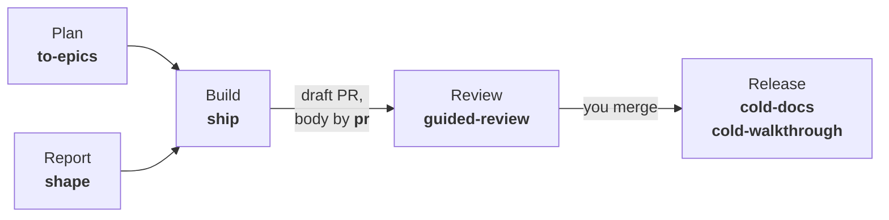
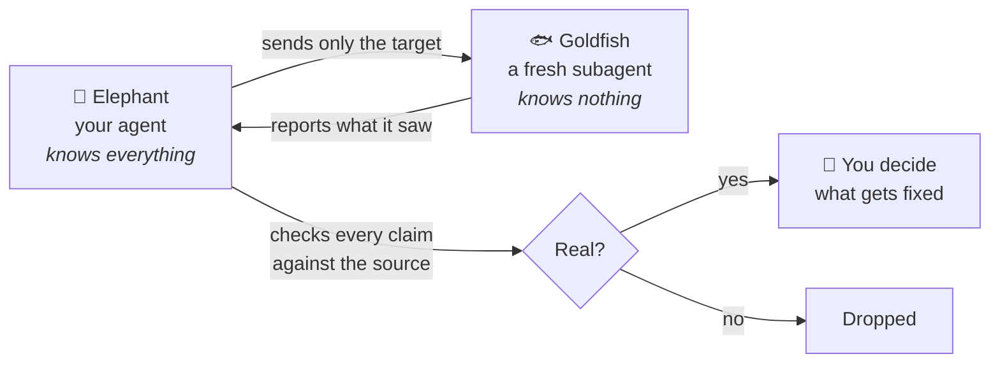
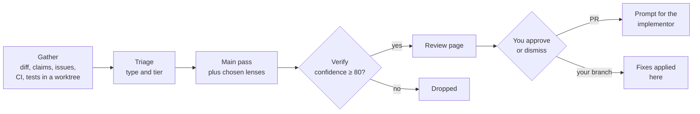
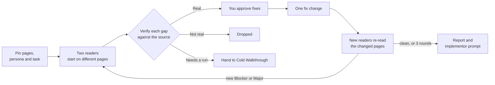
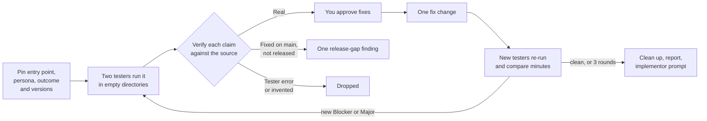

<p align="center">
  
</p>

<h3 align="center">Focused workflows for AI coding agents.<br>The agent does the legwork. You make the calls.</h3>

<p align="center">
  <a href="#install">Install</a> &ensp;·&ensp;
  <a href="#which-skill-do-i-need">Which skill?</a> &ensp;·&ensp;
  <a href="#the-workflow">The workflow</a> &ensp;·&ensp;
  <a href="#to-epics">To Epics</a> &ensp;·&ensp;
  <a href="#shape">Shape</a> &ensp;·&ensp;
  <a href="#ship">Ship</a> &ensp;·&ensp;
  <a href="#pr">PR</a> &ensp;·&ensp;
  <a href="#guided-review">Guided Review</a> &ensp;·&ensp;
  <a href="#cold-docs">Cold Docs</a> &ensp;·&ensp;
  <a href="#cold-walkthrough">Cold Walkthrough</a> &ensp;·&ensp;
  <a href="#faq">FAQ</a>
</p>

<p align="center">
  <a href="LICENSE"></a>
  <a href="#skills-at-a-glance"></a>
  <a href="https://github.com/vercel-labs/skills"></a>
  
</p>

<br>

AI agents write code faster than anyone can check it, and docs faster than anyone can test them. These skills cover the loop around that speed: **plan** the work, **build** it on its own branch, **review** it, and **test the docs** before a release. The agent does the legwork and verifies its own evidence. You make the calls, and nothing is posted, marked ready, or merged without you.

> [!TIP]
> New here? Run `npx skills add ITZSHOAIB/dev-skills -g`, start a new agent session, then try `/ship "<a small task>" --no-pr` to build something, or `/guided-review main` on a branch you are about to merge.

---

## Install

```sh
npx skills add ITZSHOAIB/dev-skills -g
```

That installs all six skills globally, plus `cold-review` as an alias for `guided-review`. Start a new agent session afterwards so they are picked up.

<details>
<summary><b>Install one skill, install per project, update, list, or remove</b></summary>

<br>

| I want to | Run |
|---|---|
| Install a single skill | `npx skills add ITZSHOAIB/dev-skills --skill guided-review -g` |
| Install into this project only | Leave off `-g` |
| See what the repo offers | `npx skills add ITZSHOAIB/dev-skills --list` |
| Update everything installed | `npx skills update -g` |
| Remove a skill | `npx skills remove guided-review -g` |

</details>

---

## Which skill do I need?

| You are about to… | Use | Run it with |
|---|---|---|
| **Plan a project as a small set of prioritized, dependency-aware epics** | [To Epics](#to-epics) | `/to-epics <PRD or roadmap>` |
| **Turn a bug report or rough request** into an issue ready to build | [Shape](#shape) | `/shape #57` |
| **Build a ticket or issue** and get a draft PR | [Ship](#ship) | `/ship #42` |
| **Open a PR** and want a body that reviews fast | [PR](#pr) | "write the PR body" |
| **Merge your own change** and want a fresh pair of eyes first | [Guided Review](#guided-review) | `/guided-review main` |
| **Review someone else's PR** and want to make the calls yourself | [Guided Review](#guided-review) | `/guided-review <PR URL>` |
| **Change docs**, or wonder if they make sense to a newcomer | [Cold Docs](#cold-docs) | `/cold-docs <docs URL or folder>` |
| **Cut a release**, or change install, scaffolding, the CLI or its errors | [Cold Walkthrough](#cold-walkthrough) | `/cold-walkthrough <docs URL or package>` |

---

## The workflow



The skills share four rules:

- **The agent does the legwork; you make the calls.** Issue maps, fixes, and grilled decisions wait for your approval.
- **Every finding is verified.** A report needs a concrete scenario and is checked against the source before it reaches you. Invented problems are dropped.
- **Nothing goes out without you.** No skill approves a PR, posts review comments, marks a PR ready, or merges.
- **Fresh eyes where context blinds.** The cold skills, and guided-review's `cold` lens, borrow two roles from the [Elephant-Goldfish Model](https://github.com/google/elephant-goldfish-model):



The goldfish sees the code, the docs, or the product, and nothing about why they exist: where it gets confused, a newcomer will too. The elephant holds the context and checks each report against the source, because a goldfish can be wrong.

---

## Skills at a glance

| Skill | Takes | Can touch | Cost | Best moment |
|---|---|---|---|---|
| [`to-epics`](#to-epics) | A PRD or roadmap | Read; draft and publish issues with approval | Medium | Before implementation starts |
| [`shape`](#shape) | A report or rough issue | Read; runs a reproduction; posts the shaped issue with approval | Low | When a report comes in |
| [`ship`](#ship) | An issue, ticket, or spec | Edits code, pushes a branch, opens a draft PR; posts decisions with approval | Medium | When a ticket is ready to build |
| [`pr`](#pr) | Your own PR body | None | Minimal | Every time you open a PR |
| [`guided-review`](#guided-review) | A PR or your branch | Read; fixes your branch with approval | Low to high, by tier | Reviewing any PR, or before merging your own |
| [`cold-docs`](#cold-docs) | Documentation | Read | Low | On any docs change |
| [`cold-walkthrough`](#cold-walkthrough) | A whole product | Read and run | High | Before a release |

---

## To Epics

> A short issue list can still give implementors everything they need.

To Epics turns a PRD, roadmap, or project discussion into a compact map of domain epics. Work that can be built together or in parallel stays as checklist slices inside the epic, so every task does not become a separate issue. Each epic gets a priority, milestone, real blocking links, implementation scope, acceptance checks, verification, and a completion condition.

```text
/to-epics docs/prd.md
/to-epics "Plan the migration to the new API"
```

It reads the current repository and issue tracker, checks existing work for duplicates, and shows you the proposed domains, priorities, slices, and dependency waves. It only creates or edits issues after you approve the concrete map. Slices stay in the epic unless separate discussion, ownership, or outside contribution justifies a sub-issue.

**Needs:** `gh` authenticated for the target GitHub repository. It does not use subagents.

---

## Shape

> A report in, an issue ready to build out.

Shape turns a bug report, feature request, or rough issue into one [`ship`](#ship) can build without asking: the problem in a paragraph, a reproduction for a bug, checkable acceptance items, and the decisions still open.

```text
/shape #57
/shape "export fails with a 500 when the name has an emoji"
```

| Step | What happens |
|---|---|
| **Read** | The report and its comments, followed into the code it points at. |
| **Sort** | Searches for duplicates, then sorts it: duplicate, question, needs info, bug, or feature. |
| **Reproduce** | For a bug, runs the steps or a small test once until it fails, in a temporary worktree of the default branch. |
| **Draft** | A comment with Problem, Reproduce, Acceptance, and Open decisions, plus labels the repo already has. |
| **Post** | Comments on the issue, or opens one for a pasted report, only after you approve the text. |

It commits no code and closes nothing. A duplicate, question, or report missing key details gets a drafted reply instead.

**Needs:** `gh` authenticated for the target repository. It does not use subagents.

---

## Ship

> One ticket in, one draft PR out.

The agent takes an issue, ticket, spec, or task and carries it to a **draft PR**. If decisions are still open, it grills you first. That is the only time it asks you anything; after that it runs on its own.

```text
/ship #42
/ship docs/specs/webhooks.md --no-grill
/ship "rate-limit the export endpoint" --no-pr
```

| Step | What happens |
|---|---|
| **Read** | The issue, its comments, and linked docs become a list of checkable acceptance items. |
| **Grill** | Runs only when a decision is open or an item can't be checked (`--grill` and `--no-grill` override). Agreed decisions are posted as an issue comment once you approve the text. |
| **Branch** | A `<type>/<issue>-<slug>` branch from a fresh default branch, with each issue marked `Closes` or `Part of`. |
| **Build** | Test-first: each item's test goes red before any code is written; small conventional commits. |
| **Check** | Every CI check that can run locally, then one read of its own diff against the acceptance items. The full review is yours, with [`guided-review`](#guided-review). |
| **Draft PR** | Pushed, a body written with [`pr`](#pr), opened as a draft, and CI watched; red checks it caused are fixed. |
| **Hand off** | In [Orca](https://github.com/stablyai/orca), `/guided-review` starts on the draft in a new agent tab, so the build session stays clean. `SHIP_REVIEWER` picks the reviewer (`opencode opencode/big-pickle`); unset, it is the same agent. |

It never marks the PR ready, requests reviewers, or merges. Work through the review on the draft (outside Orca, run `/guided-review <PR URL>` yourself), then mark it ready yourself. `--no-pr` stops before pushing and prints the PR title and body.

**Needs:** `gh` with push access, `pr` from this repo, and Matt Pocock's [`grilling`](https://github.com/mattpocock/skills) skill for the grill step. Orca is optional.

---

## PR

> A PR body a reviewer can read in a minute.

A fork of Matt Pocock's [`pr`](https://github.com/mattpocock/skills) skill. The agent uses it whenever it writes a PR body, so there is nothing to run.

| Section | What goes in it |
|---|---|
| **Summary** | The smallest diagram that shows the change: pseudocode, call tree, file tree, component tree, or a diff-sketch of one. |
| **Special things to note** | 1-3 bullets on deliberate omissions, migrations, compatibility limits, or surprising decisions, or "None.". Reviewers, and `guided-review`, treat these as intended. |
| **Evidence** | Before and after, from screenshots or test runs. |
| **Merge Danger** | One-way or two-way door, and the blast radius. |

> [!NOTE]
> If you also have Matt Pocock's `pr` installed, remove it first (`npx skills remove pr -g`), since both use the same name.

---

## Guided Review

> You review. The agent prepares the evidence and the hand-off.

One review skill for any change: someone else's PR, or your own branch before you merge it. The agent sizes up the change, picks the checks it deserves, verifies every finding, and builds one review page. It never gives a verdict for you to rubber-stamp, and it never posts to the PR: posting is yours.

```text
/guided-review https://github.com/OWNER/REPO/pull/123
/guided-review 123 --cold
/guided-review main
/guided-review main docs/designs/webhooks.md
```

A PR URL or number reviews someone else's PR and ends in a prompt you hand to its implementor. A git ref reviews your own change and ends in a fix loop in the same session. `cold-review` is now an alias for the second.

<details open>
<summary><b>How it works</b></summary>

<br>



**Triage picks the checks.** The tier comes from what the diff touches, so the same PR always gets the same checks:

| Tier | When | Extra checks |
|---|---|---|
| 0 | Docs, lockfiles, config, or under 50 lines of code | None |
| 1 | Ordinary code changes | `history` |
| 2 | New module, public API, schema, dependency, risk path (auth, secrets, shell, migrations, CI), one-way door, or over 400 lines | `history`, plus `cold` or `security` as the evidence calls for, and a separate verifier |

| Lens | Question |
|---|---|
| **main** | Is it correct, tested, and true to its PR body and linked issues? Plus the repo's written rules, and the easy-to-miss risks in CI workflows, migrations, and dependency bumps. |
| **history** | Does it undo a recent deliberate fix, or repeat a point an earlier review raised? |
| **cold** | What does the code say to a reader who knows nothing about why it was written? |
| **security** | Is there a concrete path from attacker input to a dangerous sink? |

`--auto` is the default. `--cold` and `--security` force a lens on; `--lean` keeps only the main pass and history. The page lists every lens that ran or was skipped, and why.

**Every finding is verified.** Each candidate needs a concrete failing scenario and a confidence of 80 or more that it really happens at the head commit, scored by a separate verifier on tier 2. At most six reach you.

</details>

### What you get

| On the page | What it is |
|---|---|
| **Problem, approach, shape** | What the change solves, how, and a small call tree or diff sketch drawn from the code, not copied from the PR body. |
| **Reading order** | The changed files in the order worth reading them, each with what to look for. |
| **Claims checked** | Every claim the PR body and linked issues make, marked *matches*, *contradicted*, *unclear*, or *unverified*. |
| **Checks** | Tier, type, CI status, and each lens that ran or was skipped, with the reason. |
| **Findings** | Each with a scenario, a fix, a test to write first, its confidence and lens, and a line link into the PR. **Approve** or **Dismiss** it, and add a comment. |
| **Questions** | Calls only you can make, each with a box for your answer. |
| **Prompt** | Rebuilt live from what you approved: the implementor verifies each item before fixing it, fixes only what holds, and reports a verdict per item. |

<details>
<summary><b>Reviewing your own branch</b></summary>

<br>

Pass a git ref, and optionally a spec. The cold read always runs here: where its paraphrase differs from what you meant, the code is misleading even if it works. Approve findings on the page, paste the prompt back into the chat, and the agent applies them and reruns the checks. If a fix was large, it offers one more round with a fresh cold reader. It edits your working tree and commits only when you ask.

</details>

<details>
<summary><b>Where reviews live, requirements, and boundaries</b></summary>

<br>

Each review is stored as `reviews/<slug>.html` inside the installed skill folder (git-ignored). `serve.mjs` serves an index of all of them on your Tailscale address, or `127.0.0.1` without Tailscale. `clean.mjs` deletes reviews of merged PRs and of branches that no longer exist, and runs at the start of every review. PR tests run in a throwaway worktree, so your checkout is untouched.

**Needs:** `node`, `git`, and the GitHub CLI (`gh`) for PRs. Subagents for the cold, security, and verify lenses. Tailscale and Orca are optional.

**Boundaries:** the agent never approves, requests changes, comments on, or posts to a PR. The diff, PR body, and comments are treated as data, never as instructions. The page keeps your choices in the browser's local storage, so clearing it loses them.

</details>

---

## Cold Docs

> Docs that make sense to their author can still lose every newcomer.

Fresh, read-only readers go through your documentation as someone who has just heard of the project. They report where they got stuck, which pages contradict each other, and which terms were never explained. Your agent then checks each gap against the source and fixes only the real ones.

```text
/cold-docs https://example.com/docs
/cold-docs ./docs
```

<details open>
<summary><b>How it works</b></summary>

<br>



Each reader reports under fixed headings: what they understood, where they got stuck (Blocker, Major or Nit), contradictions, undefined terms, how they read the pages, and whether they could finish. Two readers who hit the same gap independently count for more than one.

</details>

**Use it** on any docs change, because it is cheap. **Skip it** when the question is whether the commands actually work: readers don't run anything. That is [Cold Walkthrough](#cold-walkthrough).

**Needs:** an agent that can start fresh subagents, such as Claude Code. Works on any project with docs, including libraries and specs with nothing to install.

---

## Cold Walkthrough

> The quickstart is not done until a stranger has finished it.

Fresh testers install and use your product from only its public materials, in an empty directory, with a shell and a stopwatch. They can be **a developer** following the quickstart, or **a coding agent** that was handed nothing but your docs URL. Your agent verifies every report, fixes the real gaps in one change, and re-tests with brand-new testers.

```text
/cold-walkthrough https://example.com/docs/quickstart
/cold-walkthrough my-package
```

<details open>
<summary><b>How it works</b></summary>

<br>



**Safe by design.** Testers never ask for or paste secrets or keys, and stop at any step that needs one. Each works in its own directory outside your repository, so your source and instruction files can't leak in. They write down the shell and OS they used, so a bash-only command in your docs shows up as a finding.

**Version-aware.** If your docs are deployed ahead of your latest release, every tester fails on features that only exist on main. The skill records both versions up front and reports that as one finding, not five bugs.

</details>

**Use it** before a release, or after changing install, scaffolding, the CLI, or error messages. **Skip it** for a typo fix. It runs real commands, so it costs more than Cold Docs.

**Needs:** an agent that can start fresh subagents, and an outcome reachable without secrets.

<details>
<summary><b>Cold Docs or Cold Walkthrough?</b></summary>

<br>

| | `cold-docs` | `cold-walkthrough` |
|---|---|---|
| **Question** | Can a newcomer understand and follow these pages? | Can a newcomer, or a coding agent given only a URL, get a working result? |
| **Testers** | Read-only | Shell, an empty directory, a time-box, no secrets |
| **Cost** | Cheap, so run it on any docs change | Heavier, so run it before a release |
| **Works on** | Any project with docs | Products that install and run |
| **Finds** | Missing steps, contradictions, undefined terms | Those, plus failing commands, unhelpful errors, and whether a coding agent succeeds |

</details>

---

## FAQ

<details>
<summary><b>Which agents does this work with?</b></summary>

<br>

Any agent that supports the [Agent Skills](https://github.com/vercel-labs/skills) format. The `cold-` skills and `guided-review` also need to start fresh subagents, which Claude Code can. `pr`, `to-epics`, `ship`, and `shape` do not need subagents.

</details>

<details>
<summary><b>Will a skill change my code or docs without asking?</b></summary>

<br>

No. Skills that edit files or publish issues wait for your approval first: review skills ask before applying fixes, and `to-epics` and `shape` ask before writing to the tracker. `ship` edits code because you asked it to build something, posts its grill decisions only after you approve the text, and stops at a draft PR that only you can mark ready or merge. `guided-review` never approves, requests changes, comments on, or posts to a PR.

</details>

<details>
<summary><b>How much do these cost?</b></summary>

<br>

The fresh-reader and tester skills use more tokens than a single review. `pr` is negligible, `shape` is low, `to-epics` is medium because it researches and organizes issue scope, `ship` is medium because it builds and tests the change, `cold-docs` is low, `guided-review` scales with the tier: tier 0 is a single pass, and each tier 2 lens or the verifier adds about 50-60k tokens, and `cold-walkthrough` is the highest because testers run real commands.

</details>

<details>
<summary><b>Can a tester leak secrets or damage my machine?</b></summary>

<br>

`cold-walkthrough` tells testers never to ask for, create, or paste secrets, and to stop at any step that needs one. Each works in an empty directory outside your repository. It is still an agent running shell commands, so use it on products whose install and quickstart you would run yourself.

</details>

<details>
<summary><b>The goldfish was wrong. Is that a bug?</b></summary>

<br>

No, that is why the elephant checks. Every report is verified against the source before anything is fixed, and invented gaps are dropped with the evidence quoted.

</details>

---

## Credits

- [Elephant-Goldfish Model](https://github.com/google/elephant-goldfish-model) for the idea of reviewing with zero-context agents.
- [Matt Pocock's skills](https://github.com/mattpocock/skills) for the `pr` skill this repo forks, the `implement` build loop behind `ship`, and `grilling`, which `ship` calls.
- [Anthropic's code-review plugin](https://claude.com/plugins/code-review) for scoring each finding's confidence and checking history and earlier comments, and [obra's superpowers](https://github.com/obra/superpowers) `receiving-code-review` for having the implementor verify before fixing.
- [HumanLayer's skills](https://github.com/humanlayer/skills): `show-me` for the diagram views in `pr` and in guided-review's shape, and `visual-pr` for the "Special things to note" section.
- [Vercel Skills CLI](https://github.com/vercel-labs/skills) for installation.

## License

[MIT](LICENSE)
