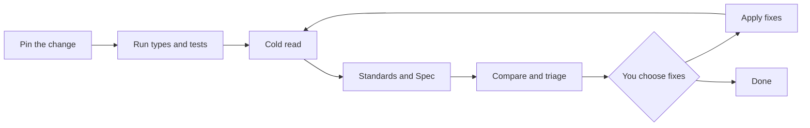

<p align="center">
  
</p>

<p align="center">
  <strong>Focused workflows for AI coding agents. You stay in charge of the decisions.</strong>
</p>

<p align="center">
  <a href="#install">Install</a> &ensp;·&ensp;
  <a href="#skills">Skills</a> &ensp;·&ensp;
  <a href="#cold-review">Cold Review</a> &ensp;·&ensp;
  <a href="#credits">Credits</a>
</p>

<p align="center">
  <a href="LICENSE"></a>
  <a href="#skills"></a>
  <a href="https://github.com/vercel-labs/skills"></a>
</p>

<br>

AI agents write code faster than anyone can check it. These skills add the checks that speed skips, and leave the judgement calls to you.

## Install

Install everything globally:

```sh
npx skills add ITZSHOAIB/dev-skills -g
```

Or pick a single skill:

```sh
npx skills add ITZSHOAIB/dev-skills --skill cold-review -g
```

Leave out `-g` to install into the current project only. Start a new agent session afterwards so the skill is picked up.

<details>
<summary>Update, list, or remove</summary>

```sh
npx skills update -g                         # update installed skills
npx skills add ITZSHOAIB/dev-skills --list   # see what this repo offers
npx skills remove cold-review -g             # remove a skill
```

</details>

## Skills

| Skill | What it does | Run it with |
|---|---|---|
| [`cold-review`](skills/cold-review/SKILL.md) | Reviews a code change with a reader who has no backstory, plus standards and spec checks, then fixes only what you approve. | `/cold-review main` |

## Cold Review

> Code that makes sense to its author can still mislead everyone else.

Most code review checks a change against what it was *supposed* to do. A reviewer who already knows the plan fills the gaps from memory, so they miss the places where the code doesn't say what you meant.

Cold Review adds the reader who doesn't know the plan. A fresh subagent gets the code and nothing else: no spec, no commit messages, no conversation. It explains what the change does, and that explanation gets compared with what you intended. **Where they differ, the code is misleading, even if it works.**

### Usage

```text
/cold-review main
/cold-review main docs/designs/webhooks.md
```

Pass a git ref to compare against, and optionally a spec.

### How it works



Standards and Spec run once. Later rounds repeat the cold read only.

Three reviews stay separate, so one can't hide problems in another:

| Axis | Question | Knows the intent? |
|---|---|---|
| **Cold read** | What does this code say by itself? | No |
| **Standards** | Does it follow this repo's rules? | Rules only |
| **Spec** | Does it do what was asked? | Yes |

Every finding then gets a verdict:

- **Fix**: a real problem, with a proposed change.
- **Keep**: deliberate, with the reason stated. If only the author knows that reason, it's a candidate for a comment or a test.
- **Verify**: not confirmed yet. It gets checked until it becomes Fix or Keep.

The agent then stops and you choose what to fix. After your fixes, a brand-new reader reviews again, until a round has no new Blocker or Major finding, or after three rounds.

### Requirements

- An agent that can start fresh subagents, such as Claude Code.
- The [`code-review`](https://github.com/mattpocock/skills) skill, which supplies the Standards and Spec reviews:

  ```sh
  npx skills add mattpocock/skills --skill code-review -g
  ```

### When to use it

Use it for changes with real design decisions. For a small, clear fix, your normal review is enough, because each round spends agent time on several reviewers.

Cold Review doesn't replace tests or human judgement. The reader is told to stay away from specs and history, but nothing enforces that, and project instruction files such as `AGENTS.md` may still load automatically.

## Credits

- [Elephant-Goldfish Model](https://github.com/google/elephant-goldfish-model) for the idea of reviewing with zero-context agents.
- [Matt Pocock's skills](https://github.com/mattpocock/skills) for the two-axis `code-review`.
- [Vercel Skills CLI](https://github.com/vercel-labs/skills) for installation.

## License

[MIT](LICENSE)
