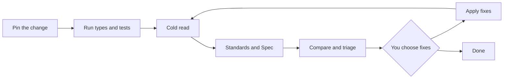

<p align="center">
  
</p>

<p align="center">
  <strong>Focused workflows for AI coding agents. You stay in charge of the decisions.</strong>
</p>

<p align="center">
  <a href="#install">Install</a> &ensp;·&ensp;
  <a href="#skills">Skills</a> &ensp;·&ensp;
  <a href="#cold-review">Cold Review</a> &ensp;·&ensp;
  <a href="#guided-review">Guided Review</a> &ensp;·&ensp;
  <a href="#pr">PR</a> &ensp;·&ensp;
  <a href="#credits">Credits</a>
</p>

<p align="center">
  <a href="LICENSE"></a>
  <a href="#skills"></a>
  <a href="https://github.com/vercel-labs/skills"></a>
</p>

<br>

AI agents write code faster than anyone can check it. These skills add the checks that speed skips, and leave the judgement calls to you.

## Install

Install everything globally:

```sh
npx skills add ITZSHOAIB/dev-skills -g
```

Or pick a single skill:

```sh
npx skills add ITZSHOAIB/dev-skills --skill cold-review -g
```

Leave out `-g` to install into the current project only. Start a new agent session afterwards so the skill is picked up.

<details>
<summary>Update, list, or remove</summary>

```sh
npx skills update -g                         # update installed skills
npx skills add ITZSHOAIB/dev-skills --list   # see what this repo offers
npx skills remove cold-review -g             # remove a skill
```

</details>

## Skills

| Skill | What it does | Run it with |
|---|---|---|
| [`cold-review`](skills/cold-review/SKILL.md) | Reviews a code change with a reader who has no backstory, plus standards and spec checks, then fixes only what you approve. | `/cold-review main` |
| [`guided-review`](skills/guided-review/SKILL.md) | Reviews a pull request as a short summary plus findings you approve or dismiss, then builds the fix prompt from your choices. | `/guided-review <PR URL>` |
| [`pr`](skills/pr/SKILL.md) | Writes a PR body that's fast to review: a diagram of the change, what's deliberate, evidence, and how risky the merge is. | "write the PR body" |

## Cold Review

> Code that makes sense to its author can still mislead everyone else.

Most code review checks a change against what it was *supposed* to do. A reviewer who already knows the plan fills the gaps from memory, so they miss the places where the code doesn't say what you meant.

Cold Review adds the reader who doesn't know the plan. A fresh subagent gets the code and nothing else: no spec, no commit messages, no conversation. It explains what the change does, and that explanation gets compared with what you intended. **Where they differ, the code is misleading, even if it works.**

### Usage

```text
/cold-review main
/cold-review main docs/designs/webhooks.md
```

Pass a git ref to compare against, and optionally a spec.

### How it works



Standards and Spec run once. Later rounds repeat the cold read only.

Three reviews stay separate, so one can't hide problems in another:

| Axis | Question | Knows the intent? |
|---|---|---|
| **Cold read** | What does this code say by itself? | No |
| **Standards** | Does it follow this repo's rules? | Rules only |
| **Spec** | Does it do what was asked? | Yes |

Every finding then gets a verdict:

- **Fix**: a real problem, with a proposed change.
- **Keep**: deliberate, with the reason stated. If only the author knows that reason, it's a candidate for a comment or a test.
- **Verify**: not confirmed yet. It gets checked until it becomes Fix or Keep.

The agent then stops and you choose what to fix. After your fixes, a brand-new reader reviews again, until a round has no new Blocker or Major finding, or after three rounds.

### Requirements

Cold Review only needs an agent that can start fresh subagents, such as Claude Code.

### Recommended

Matt Pocock's [`code-review`](https://github.com/mattpocock/skills) gives more thorough Standards and Spec reviews:

```sh
npx skills add mattpocock/skills --skill code-review -g
```

If it's missing, Cold Review asks before installing it. Say no and it runs its own shorter built-in reviews, and the report tells you which ones ran.

### When to use it

Use it for changes with real design decisions. For a small, clear fix, your normal review is enough, because each round spends agent time on several reviewers.

Cold Review doesn't replace tests or human judgement. The reader is told to stay away from specs and history, but nothing enforces that, and project instruction files such as `AGENTS.md` may still load automatically.

## Guided Review

> You review. The agent prepares the evidence and the hand-off.

The agent reads a pull request, checks its test claims, and builds one review page. It makes no verdict for you to rubber-stamp.

### Usage

```text
/guided-review https://github.com/OWNER/REPO/pull/123
/guided-review https://github.com/OWNER/REPO/pull/123 --deep --cold
```

The default is one lean pass by the agent. `--deep` adds a Standards review (from `code-review`) and `--cold` adds a zero-context cold read (from `cold-review`); each costs roughly 40k extra tokens, and their findings go through the same filter.

### What you get

- **Problem and approach**: two short paragraphs on what the PR solves and how.
- **Shape of the change**: one small call tree, file tree, or diff-sketch of what the diff actually does, drawn from the code rather than copied from the PR body.
- **Findings**: at most six, each with a failing scenario, a suggested fix, and optionally a few lines of shape that place the defect. You press **Approve** or **Dismiss** and can add your own comment.
- **Questions**: calls only you can make, each with a box for your answer.
- **Implementor prompt**: rebuilt live from the findings you approved and your comments, ready to paste into the agent that wrote the PR.

### Checking the PR's own claims

Besides the test claims, the agent checks the PR body's Summary diagram, **Special things to note**, and **Merge Danger** against the diff, when the body has them. A claim the diff contradicts becomes a finding; a claim too vague to check becomes a question. Whatever the body lists as deliberately left out is not reported as a defect. The page lists every claim it checked under **PR claims**, each marked matches, contradicted (linked to its finding), or unclear (linked to its question), so you can see the check ran even when everything matched. PR bodies written with [`pr`](#pr) have all three sections. With `--cold`, the zero-context reader also draws its own shape of the change, and any gap from the PR's diagram is checked as a surprise.

### Where reviews live

Each review is stored as `reviews/<owner>-<repo>-pr-<n>.html` inside the installed skill folder (git-ignored). `serve.mjs` serves an index of all of them on your Tailscale address, or `127.0.0.1` without Tailscale. `clean.mjs` deletes the reviews of merged PRs, and the skill runs it at the start of every review.

### Requirements

`node` and the GitHub CLI (`gh`). Tailscale and Orca are optional.

### Boundaries

The agent never approves, requests changes, or posts to the PR. The page keeps your choices in the browser's local storage, so clearing it loses them.

## PR

> A PR body a reviewer can read in a minute.

Fork of Matt Pocock's [`pr`](https://github.com/mattpocock/skills) skill. The body has four sections:

- **Summary**: the smallest diagram that shows the change (pseudocode, call tree, file tree, component tree, or a diff-sketch of one).
- **Special things to note**: 1-3 bullets on deliberate omissions, migrations, compatibility limits, or surprising decisions, or "None.". Reviewers, and `guided-review`, treat these as intended.
- **Evidence**: before and after, from screenshots or test runs.
- **Merge Danger**: one-way or two-way door, and the blast radius.

The agent uses it whenever it writes a PR body. If you also have Matt Pocock's `pr` installed, remove it first (`npx skills remove pr -g`), since both use the same name.

## Credits

- [Elephant-Goldfish Model](https://github.com/google/elephant-goldfish-model) for the idea of reviewing with zero-context agents.
- [Matt Pocock's skills](https://github.com/mattpocock/skills) for the two-axis `code-review` and the `pr` skill this repo forks.
- [HumanLayer's skills](https://github.com/humanlayer/skills): `show-me` for the diagram views in `pr` and in guided-review's shape, and `visual-pr` for the "Special things to note" section.
- [Vercel Skills CLI](https://github.com/vercel-labs/skills) for installation.

## License

[MIT](LICENSE)
